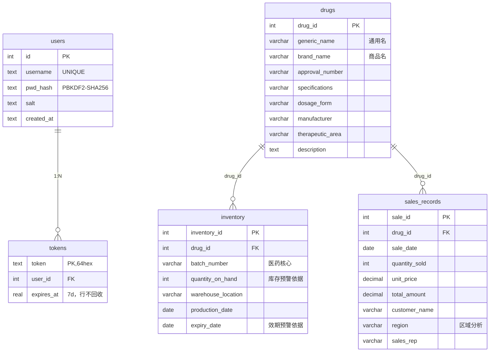

# 基准功能矩阵与完成度分析报告 · Deep Agent Search

## 0. 元信息与产出说明

| 项 | 内容 |
|---|---|
| 文档名称 | 基准功能矩阵与完成度分析（as-built 逆向基线） |
| 版本 | v1.0（基线 baseline） |
| 状态 | 评审稿（作为"对照方案查完成度"的唯一基准） |
| 作者角色 | pm（产品经理，受 chief 派单） |
| 日期 | 2026-10-15 |
| 项目根 | `D:\ deep_agent search`（目录名以空格开头，命令行引用必须加引号） |
| 所依据的上游文档 | **无**（已核实 git 全 7 个 commit 无 PRD/SPEC；`docs/` 仅《一键启动速查表》《站内工作台深色改造说明》） |
| 证据口径 | 每条结论必须带 `文件:行号`；本次只读实测到的命令输出另附；无证据一律标"未验证" |

**关于两个 skill 的适用性说明（务必先读）**

| Skill | 本报告的用法 | 未套用的部分与理由 |
|---|---|---|
| `prd-author` | 借用其 **Phase 4 功能需求池**（FR 编号 + P0/P1/P2 + 表头结构）、**Phase 2 角色权限矩阵**、**Phase 8 数据实体**、**Phase 12 质量自检** | Phase 3「用户故事」、Phase 6「业务流程图」按正向需求编写，本项目是**反向盘点**（先有代码后要什么），强行编故事会违反"严禁凭想象补功能"红线，故不写；Phase 1 的量化成功标准改为"实测完成度百分比" |
| `design-spec-author` | 借用其 **Phase 6 接口契约**（→ §4 前后端契约对照表）、**Phase 5 数据模型**（→ §2.7）、**Phase 8 非功能**（→ §2.8 安全/可用性现状）、**Phase 3 模块划分**（→ §2 模块分组） | Phase 9「ADR 设计决策记录」不产出：本项目的选型理由无任何文档记录，凭代码倒推 ADR = 臆造决策动机，故只列"事实性推断"并标注为推断 |

本报告的新增维度（两个 skill 都没有的）：**状态 / 证据 / 是否实测 / 当前可用性**四列，这是"基准矩阵"的核心，由佳总任务书指定。

### 0.5 基准锚定与并发变更告警（必读）

**① 本基准锚定在 `HEAD = 50c38a9`（"fix(启动): 一键启动三处修复 + 补充速查与改造说明文档"）。**
我读取 `agent/`、`api/`、`tools/` 时（2026-10-15 14:15~14:25）工作区与 HEAD 完全一致，已逐条复核行号对齐：`git show HEAD:api/server.py` 的 280-282 行仍是嵌套同名 `start_server`、`git show HEAD:tools/mysql_tools.py:26` 仍是 `autocommit: True`、`git show HEAD:agent/main_agent.py:104-106` 仍是那句"智能体执行最终失败了"、`git show HEAD:agent/llm.py` 仍是 12 行。**所以下文所有 `文件:行号` 均对 HEAD 负责。**

**② 告警：本次盘点期间有成员并发修改了同一批文件，工作区已不等于 HEAD。**
14:38 复核 `git status` 出现 7 个已改动文件（`git diff --stat`）：`api/server.py`(±226)、`tools/mysql_tools.py`(±234)、`agent/main_agent.py`(±99)、`tools/ragflow_tools.py`(±74)、`api/monitor.py`(±68)、`agent/llm.py`(±25)、`utils/path_utils.py`(±16)。抽样确认修复已在进行：`api/server.py:11,134,165,197,230` 已引入 `Depends(require_user)`，`agent/main_agent.py` 已出现 `get_main_agent`/`describe_agent_failure`，`agent/llm.py` 已出现 `get_model`。

对基准的影响与处置：

| 条目 | 状态 | 处置 |
|---|---|---|
| AG-05 / AG-11 / AP-01 / AP-02 / AP-04 / AP-06 / AP-10 / TL-01~03 / TL-11 / AU-08 / DF-04 | **基准仍记为"未实现/部分完成"**（HEAD 事实） | 不动矩阵。等该成员改动定稿后，由 chief 派单做**一次增量复核**，把行号重锚到新 HEAD 并把状态上调；在复核前任何人引用本报告，按"基线快照"理解 |
| 其余 54 条（前端 UI/认证服务/编排/数据底座/文档） | 未受影响 | 结论直接可用 |
| `docs/` 其余两份、`README.md`、`ui/`、`auth_service/`、`docker/` | 无并发改动 | 结论直接可用 |

**③ 新增凭据外泄面（并入 §5 第 8 条）**：工作区现有**两个** env 备份 `/.env.bak`(829 B) 与 `docker/.env.docker.bak`(859 B，今日 14 点后新增)，两者均未被 `.gitignore` 覆盖（`.gitignore:29-31` 只忽略 `.env`、`.env.local`、`docker/.env.docker`）。我未打开这两个文件。并发改动 env 文件的人如果不清楚这点，等于把密钥复制到了两条不受忽略规则保护的路径上。

---

## 1. 一页结论

### 1.1 完成度百分比（按功能点优先级加权）

权重规则：P0=3、P1=2、P2=1。分值规则：已完成=1.0 / 部分完成=0.5 / 仅有骨架=0.2 / 完全未实现=0。

| 口径 | 加权完成度 | 说明 |
|---|---:|---|
| **代码实现完成度** | **69.2%** | "写出来的代码占应做的多少" |
| **当前可实测可用度** | **50.4%** | "此刻真能跑通并验证到的多少"（智能体主链路 + 联网 + 知识库三条腿全断，直接压掉 18.8 个百分点） |

分层看（实现 / 可用）：

| 优先级 | 功能点数 | 实现完成度 | 当前可用度 | 一句话 |
|---|---:|---:|---:|---|
| P0（主流程必须） | 35 | 80.6% | **55.7%** | 骨架齐全，但"智能体本身"和"鉴权"两条腿是空的 |
| P1（重要） | 22 | 48.6% | 43.2% | 多轮记忆、取消任务、表结构工具、Word 生成等长期欠账 |
| P2（可选） | 8 | 33.8% | 21.2% | 预览、token 清理、目录治理、角色权限基本没动 |

功能点总数 **65**（比任务书建议的 30~50 略多）。理由：4 个服务 × 2 层（实现/可用性）交叉，颗粒再粗就无法逐条给证据；本表是后续"对照方案查完成度"的唯一基准，宁可细不可糊。

### 1.2 现在能用的 / 不能用的

| 能力 | 状态 | 证据 |
|---|---|---|
| 前端静态站 + 深色 HUD 工作台 | ✅ 可用 | 本次 `docker compose ps`：frontend Up 3h；`docs/站内工作台深色改造说明.md:178-236` 有 50 元素对比度实测 |
| 登录 / 注册 / 登出 / token 校验 / 失败限流 | ✅ 可用 | 本次实测 `GET /api/auth/me` 无 token → `401 {"detail":"未提供认证凭证"}`；`auth_service/main.py:205-217`；demo 账号可拿 token（既有事实） |
| MySQL 业务库 | ✅ 可用 | 本次实测 `select count(*)`：drugs **10** / inventory **30** / sales_records **20**；`sql/db.sql:10-56` |
| 数据库查询子智能体（代码链路） | ✅ 代码完成，历史跑通 | 本次实测 `GET /api/files?path=/app/output` 返回真实文件列表；`output/session_local_test_f31271a1/库存预警清单.md`（6,558 B，含真实批号/库存数，明显来自 `pharma_db`） |
| 产物文件列表 / 下载 | ✅ 可用 | 本次实测下载 `/app/output/session_demo-1234abcd/库存预警清单.pdf` → `HTTP 200 application/pdf 237,575 B` |
| 容器内 Markdown→PDF | ✅ 有物证 | 上述 PDF 元数据 `/Producer = WeasyPrint 70.0`（pypdf 实测）→ 证明 `docker/shim/sitecustomize.py:17-24` 垫片真实生效过；但**由谁触发（智能体或手工）未定**，且不等于当前可复现 |
| nginx 网关（API / auth / WS / SPA / 200m / gzip） | ✅ 可用 | 本次 WS 握手经 8080 → `HTTP 101 Switching Protocols`；`docker/nginx.conf:5,20,39,54,72` |
| 一键启动脚本（三平台 + 预检 + 探活 + 密码自举） | ✅ 可用 | `start.ps1:82-274`、`start.sh:36-152`、`start.bat:20`（透传）；`docs/一键启动速查表.md:67-152` |
| **主智能体端到端（任意提问）** | ❌ **不可用** | `docker/.env.docker` 的 `DASHSCOPE_API_KEY` 已失效（既有事实：两个 endpoint 均 401）→ `agent/main_agent.py:104-106` 只回传一句"智能体执行最终失败了" |
| **联网搜索子智能体** | ❌ 不可用 | 容器内 Tavily HTTPS 握手 `SSL: UNEXPECTED_EOF_WHILE_READING`；`tools/internet_search_tool.py:37` 无异常兜底，直接把异常抛给 LLM |
| **RAGFlow 知识库子智能体** | ❌ 不可用 | `RAGFLOW_API_URL=http://118.195.130.244` 80 端口 15s 超时；`tools/ragflow_tools.py:8-11` 客户端在 import 期构造 |
| **业务接口的鉴权（/api/task、/api/upload、/api/files、/api/download、/ws）** | ❌ **完全没有** | `api/server.py:70,100,131,162,234` 五个入口函数签名里没有 `Depends`；本次实测不带任何 token 即可列目录、下载 PDF、建立 WS |
| **多轮对话（上下文延续）** | ❌ 完全没有 | `agent/main_agent.py:95-100` 每次只塞当前一条 user 消息，`create_deep_agent` 未传 `checkpointer`（`agent/main_agent.py:20-25`） |

### 1.3 头号阻塞（唯一决定"这项目现在能不能演示"的那一颗）

> **`DASHSCOPE_API_KEY` 失效 = 智能体主链路 100% 不可用。**
> 其余一切（前端、网关、认证、数据库、文件面板、下载）都在它下游，所以它一断，产品价值归零，只剩一个"能登录的空工作台"。
> 次级阻塞：RAGFlow 外部服务不可达、Tavily 容器内 SSL 失败 —— 三条信息获取腿全断，即便换回 LLM key，也只能跑"纯数据库"一种任务。
> 结构性阻塞（换 key 也治不了）：**接口无鉴权 + 会话不绑用户**，这决定了它现在不能对外、不能多租户、不能当真产品用。

---

## 2. 功能矩阵表（基准，65 点）

状态口径：**已完成**=代码写完且逻辑自洽；**部分完成**=能用但有明确缺口/副作用；**仅有骨架**=入口在但核心逻辑缺失；**未实现**=代码里没有，且 prompt/README/前端有承诺。
"实测"列：**本次**=我在 2026-10-15 只读实测；**物证**=仓库里的历史产物；**静态**=只读到代码，未运行；**未验证**=拿不准。

### 2.1 智能体核心（AG）

| 编号 | 功能点 | 优先级 | 状态 | 证据（文件:行号） | 实测 | 备注 |
|---|---|---|---|---|---|---|
| AG-01 | 主智能体编排：3 子智能体 + 3 工具挂载 | P0 | 已完成 | `agent/main_agent.py:20-25`（`subagents=[rag,db,internet]`、`tools=[read_file_content,generate_markdown,convert_md_to_pdf]`） | 静态 | 当前因 LLM 401 整链不可用 |
| AG-02 | 数据库查询子智能体 | P0 | 已完成 | `agent/sub_agents/db_sub_agent.py:5-10`；`prompt/prompts.yml:53-64` | 物证 | `output/session_local_test_f31271a1/库存预警清单.md` 数据与 `pharma_db` 一致 |
| AG-03 | 联网搜索子智能体 | P0 | 已完成 | `agent/sub_agents/network_search_agent.py:5-10`；`prompt/prompts.yml:45-52` | 未验证 | 容器内 Tavily SSL 失败；历史产物（2026-08-21 的连花清瘟报告）说明曾经可用 |
| AG-04 | RAGFlow 知识库子智能体 | P0 | 已完成 | `agent/sub_agents/rag_sub_agent.py:4-9` | 未验证 | 上游服务不可达；`prompt/prompts.yml:69-70` 的 system_prompt 只有 1 行"你是一个专业的RAGFlow知识库助手"，无任何工具指引 |
| AG-05 | LLM 接入（OpenAI 兼容 / qwen） | P0 | 部分完成 | `agent/llm.py:7-12`（`init_chat_model` 在 **import 期**执行） | 静态 | 无惰性构建、无 timeout/max_retries、无备用模型；key 缺失或失效时后端整体不可用。`tests/test_llm_lazy.py:1,31` 已写下期望（要求 `get_model()`），代码未实现 |
| AG-06 | Prompt 外部化配置 | P1 | 已完成 | `agent/load_prompts.py:11-17`；`prompt/prompts.yml` 全 69 行 | 静态 | 结构清晰（main_agent + 3 个 sub_agents） |
| AG-07 | 多轮对话 / 上下文记忆 | P0 | **未实现** | `agent/main_agent.py:20-25`（无 `checkpointer`）、`:95-100`（`messages` 只含本轮 user）；`api/server.py:89,93`（thread_id 仅用于目录与 WS 路由） | 静态 | DeepAgents 支持 `checkpointer`/`store`（`.venv/.../deepagents/graph.py:285-286`），项目未传。**前端看起来是连续对话，后端每一条都是失忆的新任务** |
| AG-08 | 子智能体/工具执行结果回传 | P1 | 部分完成 | 只上报"调用意图"：`agent/main_agent.py:40,43`；返回结果的分支被整段注释：`agent/main_agent.py:47-51` | 静态 | 前端时间线只能显示"正在用什么"，永远看不到"查到了什么" |
| AG-09 | 任务取消 / 人工确认（human-in-the-loop） | P1 | **未实现** | 全仓无 `interrupt_on`/`cancel`/`abort` 用法（DeepAgents 支持：`graph.py:280`）；`api/server.py` 无取消接口 | 静态 | 任务一旦发起只能等它自己结束 |
| AG-10 | DeepAgents 内建能力接入（`ls/read_file/write_file/edit_file/glob/grep/execute`、`memory`、`skills`、`permissions`、`backend`） | P1 | **未实现（且被默认值坑）** | `agent/main_agent.py:20-25` 未传 `backend` → 落到默认 `StateBackend()`（`graph.py:627`），内建 `write_file` 写进图状态、**不落盘**；`permissions` 未设 | 静态 | 模型若用内建 `write_file` 而非 `generate_markdown`，产物不会出现在文件面板 → 与 `prompt/prompts.yml:18,30-32` 的工具叙述冲突；同时内建工具名 `write_todos`/`write_file` 不在前端映射表（`ui/src/types.ts:75-82`） |
| AG-11 | 失败根因可诊断回传 | P0 | 仅有骨架 | `agent/main_agent.py:104-106`：`except Exception` → 只发 `monitor._emit("error","智能体执行最终失败了")` | 本次（现象） | 前端只显示这 6 个字，用户完全不知道该换哪个 key。`tests/test_main_agent.py:77-103` 已把期望写成 `describe_agent_failure()`（要求区分 API Key / 超时 / SSL / RuntimeError），代码未实现 |
| AG-12 | 本地冒烟入口（不起 FastAPI 直接跑智能体） | P2 | 已完成 | `agent/main_agent.py:110-152`（含 `builtins.runtime` 假运行时，配合 `api/monitor.py:87-91`） | 物证 | `session_local_test_f31271a1` 就是这条入口留下的产物 |

### 2.2 工具层（TL）

| 编号 | 功能点 | 优先级 | 状态 | 证据 | 实测 | 备注 |
|---|---|---|---|---|---|---|
| TL-01 | `list_sql_tables` 列表 | P0 | 已完成 | `tools/mysql_tools.py:78-104` | 静态 | `show tables` |
| TL-02 | `get_table_data` 预览前 100 行 | P0 | 已完成 | `tools/mysql_tools.py:116-152`；`:129` 用 f-string 拼表名 | 静态 | **SQL 注入**（表名未白名单） |
| TL-03 | `execute_sql_query` 自定义 SQL | P0 | 已完成（**过强**） | `tools/mysql_tools.py:158-192`；`:170` 原样执行；`:26` `autocommit=True` | 静态 | 可跑任意 DML/DDL；`tests/test_mysql_tools.py:1,40` 要求只读守卫，未实现 |
| TL-04 | 表结构专用工具（DESCRIBE） | P1 | **未实现** | `prompt/prompts.yml:56` 声称"读取表数据和查看表结构"，但 `tools/mysql_tools.py` 只有 3 个工具（`:78,116,158`），`db_sub_agent.py:9` 只挂这 3 个 | 静态 | 只能靠模型自己写 `describe`，属"prompt 承诺 > 工具实现" |
| TL-05 | `internet_search`（Tavily） | P0 | 已完成（无兜底） | `tools/internet_search_tool.py:15-42`；`:37` 直接 `return _tavily_client.search(...)` | 未验证 | 无 try/except；返回**裸 dict**（含 5 条结果 + 分数），未按 `prompts.yml:52` 约束做裁剪，token 消耗不可控 |
| TL-06 | RAGFlow 助手列表 + 一次性问答 | P0 | 已完成 | `tools/ragflow_tools.py:13-40,48-79` | 未验证 | `:67-75` 问答异常时 `delete_sessions` 不执行 → 远端临时会话泄漏；`:8-11` 客户端 import 期构造 |
| TL-07 | `generate_markdown` 成稿 | P0 | 已完成 | `tools/markdown_tools.py:11-54`；`:33` 走 `resolve_path`；`:48` `write_text` | 物证 | 多份 `.md` 落盘为证 |
| TL-08 | `convert_md_to_pdf`（MD→PDF） | P0 | 已完成 | `tools/pdf_tools.py:12-45`；`:41`→`utils/converter_utils.py:8-51`（Word COM） | 物证 + 本次 | 6 份 PDF 落盘；`session_demo-1234abcd/*.pdf` 元数据 = WeasyPrint 70.0（容器垫片生效过）；该 PDF 本次可下载。**容器内是否 100% 可复现：未验证** |
| TL-09 | Word（.docx）**生成** | P1 | **未实现** | `prompt/prompts.yml:18,30` 两处承诺"Markdown、Word、PDF 三种格式"；`tools/` 下无任何 docx 写出工具（`upload_file_read_tool.py:48` 只能**读** docx）；`main_agent.py:24` 只挂 3 个工具 | 静态 | 用户要 Word 只能拿到 md+pdf，README/前端能力胶囊也未宣称 Word（`ChatView.vue:458`）→ prompt 与现实三方不一致 |
| TL-10 | `read_file_content` 多格式读取 | P0 | 部分完成 | `tools/upload_file_read_tool.py:21-83`：md/txt(`:44`)、docx(`:48`)、pdf(`:53`)、xlsx/xls(`:58`)、兜底文本(`:76-80`) | 静态 | **图片无任何处理**，但前端拖拽遮罩写"PDF / Word / Markdown / 图片 / 表格"（`ChatView.vue:798`）；`:12-19` 是被废弃的旧函数签名残留注释 |
| TL-11 | 路径清洗与会话目录隔离 | P0 | 部分完成 | `utils/path_utils.py:41-110` | 静态 | 两处硬伤：① `:96` "绝对路径但不在 session_dir 下 → 保持原样"，即**越界写入只放行不拦截**；② `:56-59` 只要路径含 `upload/` 就 `Path(相对段).resolve()` 返回，`upload/../../x` 可逃逸到 CWD 之外 |
| TL-12 | 工具内进度上报（`monitor.report_tool`）一致性 | P1 | 部分完成 | 工具内部传中文名：`mysql_tools.py:85,125,166`、`ragflow_tools.py:21,57`、`internet_search_tool.py:34`、`markdown_tools.py:19`、`pdf_tools.py:21`、`upload_file_read_tool.py:30`；主智能体侧传英文工具名：`main_agent.py:43` | 静态 | 一次主智能体工具调用产生 **2 条** `tool_start`（英文名 + 中文名），前端时间线步骤翻倍；且 `ui/src/types.ts:75-82` 的映射表只认英文，还含一个不存在的 `query_database` |

### 2.3 后端 API 服务（AP）

| 编号 | 功能点 | 优先级 | 状态 | 证据 | 实测 | 备注 |
|---|---|---|---|---|---|---|
| AP-01 | `POST /api/task` 异步起任务并回 thread_id | P0 | 已完成 | `api/server.py:66-97`（`:89` 缺省 uuid；`:93` `asyncio.create_task`） | 静态 | 无鉴权、无请求体上限、无并发/QPS 限制、无任务状态查询；每次调用即 `output/session_*` 建目录（`main_agent.py:61`）且永不回收 |
| AP-02 | `POST /api/upload` 多文件上传 | P0 | 部分完成 | `api/server.py:100-129`；`:115` `upload_dir / f"session_{thread_id}"`；`:121` `target_dir / file.filename` | 静态 | 无鉴权、**thread_id 与 file.filename 均未清洗**（路径穿越面）；无类型/大小/数量校验（仅 nginx 200m 兜底，`docker/nginx.conf:5`） |
| AP-03 | `GET /api/files` 产物目录列表 | P0 | 已完成 | `api/server.py:162-227`；`:190` 限定 `output/` 下；`:202` `rglob("*")` 递归；`:219` 按 mtime 倒序 | **本次** | 无 token 即可 `?path=/app/output` 列出**全部会话**的文件（实测返回 demo 会话条目）；越界路径实测返回 `HTTP 200 + {"files":[],"error":"拒绝访问..."}`（**用 200 表达 403**）；注意必须传**容器内路径**，传宿主机 `D:/...` 实测被拒（前端能正常显示只因 monitor 下发的是容器路径） |
| AP-04 | `GET /api/download` 文件下载 | P0 | 已完成 | `api/server.py:131-159`；`:149` `is_relative_to(output)` | **本次** | 实测 `/app/output/session_demo-1234abcd/库存预警清单.pdf` → `200 application/pdf 237,575 B`；实测 `/app/output/../docker/.env.docker` → 被拦（`200 + {"error":"拒绝访问..."}`）。**全程无需 token**；拒绝/文件不存在都是 200，不是 403/404 |
| AP-05 | `WS /ws/{thread_id}` 实时推送 + 心跳 | P0 | 部分完成 | `api/server.py:234-277`（`:255` accept、`:261-267` ping→pong）；`api/monitor.py:130-133,143-146` | **本次**（握手 101） | ① 无鉴权，任何人可用任意 thread_id 连上；② 同 thread_id 第二次 connect **直接覆盖**且不关旧 socket（泄漏，`tests/test_monitor.py:94-117` 已要）；③ 若某 thread 当前无连接，事件**静默丢弃**（`monitor.py:143-146` 无队列/重放）→ 断线期间的结果永久丢失 |
| AP-06 | 业务接口鉴权（token 校验） | P0 | **未实现** | `api/server.py` 全文无 `Depends`/`Authorization` 解析（仅 CORS `:46-52`）；对照 `auth_service/main.py:205-217` 有现成 `current_user` 却未被后端引用 | **本次** | 后端与认证是两个互不认识的服务：前端 `api.ts:37-41` 老老实实带了 Bearer，后端完全不看 |
| AP-07 | 任务状态 / 会话历史查询接口 | P1 | **未实现** | `api/server.py` 只有 task/upload/download/files/ws 五个入口 | 静态 | 历史会话只能躺在浏览器 localStorage（UI-08） |
| AP-08 | `GET /health` 健康探针 | P1 | **未实现** | 后端无 health 路由；`docker-compose.yml:39-45` 只给 mysql 配了 healthcheck，backend/auth 没有；`start.ps1:324-326` 退而求其次探 `/docs` | **本次**（/docs=200） | `/docs` 能开只说明进程活着，不说明 LLM/RAG/网络可用——正是本次故障没人第一时间发现的原因 |
| AP-09 | CORS 策略 | P1 | 部分完成 | 后端 `api/server.py:46-52` `allow_origins=["*"]` + `allow_credentials=True`；auth `auth_service/main.py:25-37` 可由 `CORS_ALLOW_ORIGINS` 收敛（compose 未设→回落 `*`）；网关 `docker/nginx.conf:31-35,46-50,64-68` 统一 `proxy_hide_header` 剥 CORS | 静态 | 网关剥离是当前**唯一实际防线**；一旦有人直连 8000/8001（本机即可），"*" 立刻生效 |
| AP-10 | `python main.py` 本地启动入口 | P2 | 仅有骨架 | `main.py:1-4` 调 `start_server()`；但 `api/server.py:280-282` 是**嵌套同名函数**：外层只 def 了内层、从未调用 → `python main.py` 空跑退出 | 静态 | Docker 走 `CMD uvicorn`（`docker/backend.Dockerfile:41`）所以不影响容器；`tests/test_server_entry.py:1,9-14` 已写下期望 |
| AP-11 | 产出/上传目录生命周期治理 | P2 | **未实现** | `main_agent.py:61` 只 mkdir 无清理；全仓无 TTL/GC 逻辑 | **本次** | `output/` 现有 30 个 session 目录，**19 个是空的**（失败任务留下的孤儿），已占仓库 14 MB 且被 git 跟踪（见 §2.8） |

### 2.4 认证微服务（AU）

| 编号 | 功能点 | 优先级 | 状态 | 证据 | 实测 | 备注 |
|---|---|---|---|---|---|---|
| AU-01 | 注册（含注册即发 token） | P0 | 已完成 | `auth_service/main.py:231-261`（`:242-243` 随机盐 + PBKDF2；`:255-259` 直接发 token） | 本次（既有）| 前端注册后又调一次 login（`RegisterView.vue:87-90`），多一个来回，属冗余而非缺陷 |
| AU-02 | 登录 + Bearer token | P0 | 已完成 | `auth_service/main.py:264-284`；token = `secrets.token_hex(32)`，TTL 7 天（`:20`） | 本次（既有）| 无 token 轮换、无 refresh |
| AU-03 | `GET /api/auth/me` 身份校验 | P0 | 已完成 | `auth_service/main.py:294-296` + `:205-217` | **本次** | 无凭证实测返回 `401 {"detail":"未提供认证凭证"}`，语义正确（对比 AP-03/AP-04 的 200 表达拒绝） |
| AU-04 | 登出（吊销 token） | P1 | 已完成 | `auth_service/main.py:287-291` `DELETE FROM tokens` | 静态 | 前端已接（`ChatView.vue:345-355`） |
| AU-05 | 登录/注册失败限流（双闸门） | P1 | 已完成 | `auth_service/main.py:56-150`：5 分钟滑窗、账号 10 次/IP 60 次（`:63-64`）、429 + Retry-After（`:111-115`）、key 上限 20k 防撑内存（`:65,135-140`） | 静态 | 进程内实现，多 worker 会失效（`:54-55` 注释自陈） |
| AU-06 | 密码安全存储（PBKDF2-SHA256 120k 轮 + 常数时间比较） | P0 | 已完成 | `auth_service/main.py:183-190`（120_000 轮、`hmac.compare_digest`）；表结构 `:165-177` | 静态 | 明文不落库 |
| AU-07 | 过期 token 清理 | P2 | **未实现** | 全文件无清理任务；`tokens` 表只插不删（`:256-259,279-282`） | 静态 | 过期只在 `current_user` 查询时判断（`:215`），行永远留着 |
| AU-08 | **用户 ↔ 会话(thread_id) ↔ 产物目录绑定（多租户隔离）** | P0 | **未实现** | `api/context.py:34-38` 只有 `session_dir` 与 `thread_id` 两个 ContextVar，**没有 user 维度**；`api/server.py:89,115` thread_id 由客户端自报，与登录用户无关 | **本次** | 后果：任何人拿到/猜到 thread_id 就能读别人的会话文件、发任务、占 WS；文件面板实测可列出所有会话产物 |
| AU-09 | 角色与权限（管理员 / 审计日志） | P2 | **未实现** | `users` 表无 role 字段（`auth_service/main.py:165-171`）；全仓无 audit 日志 | 静态 | 权限矩阵只有"登录用户"一档 |

### 2.5 前端（UI）

| 编号 | 功能点 | 优先级 | 状态 | 证据 | 实测 | 备注 |
|---|---|---|---|---|---|---|
| UI-01 | 登录页 / 注册页（无 router 的 stage 切换） | P0 | 已完成 | `ui/src/App.vue:9-42`（checking/guest/authed，`onMounted` 用 `/api/auth/me` 校验）；`LoginView.vue:64-85`、`RegisterView.vue:78-98` | 本次（既有） | 登录→拿 token→进工作台；注册链路已实测可用 |
| UI-02 | 深色 HUD 工作台（三栏 + 背景层 + 角标） | P1 | 已完成 | `ChatView.vue:499-802` 模板；`ChatView.vue:806-865` 背景层；`ui/src/cover.css`、`ui/src/style.css` 令牌层；`docs/站内工作台深色改造说明.md:26-52` | 既有实测 | 遗留：`.logo` 4.27:1、`.avatar` 4.33:1 两处对比度未达标（`docs/...说明.md:195-207`） |
| UI-03 | 消息流 + Markdown 渲染 | P0 | 已完成（**不安全**） | `ChatMessage.vue:3,7,21-23`（marked, gfm）、`:194` `v-html="bodyHtml"` | 静态 | `ui/package.json:11-15` 依赖只有 axios/marked/vue，**无 DOMPurify**，`marked` 默认原样透传 HTML → 智能体输出（含 DB 内容、网页内容、上传文件内容）里的 `<script>`/`` 会被执行 → **存储/反射型 XSS** |
| UI-04 | 执行步骤时间线 + 每步耗时 | P1 | 部分完成 | `ChatView.vue:155-192` 落 logs；`ChatMessage.vue:37-53`（耗时 = 下一条事件到达时刻 − 本条）、`:61-67` 名称映射；`ui/src/types.ts:75-82` 映射表 | 静态 | 后端没有 `tool_end` 事件（`api/monitor.py:96-111` 只有 start/assistant/result/session），所以"每步耗时"是**事件间隔估算**，不是真实执行时长；映射表缺 `write_todos`/中文名/内建工具名 |
| UI-05 | 产物文件面板 + 下载 | P0 | 已完成 | `ChatView.vue:224-235` fetchFiles；`FilePanel.vue:13-26,54-77`（行即 `<a href=/api/download>`） | **本次** | 下载接口无鉴权，前端也没打算带 token（`api.ts:75` 只拼 URL） |
| UI-06 | PDF / Markdown 在线预览 | P2 | **未实现** | 全前端无 `<iframe>`/`<embed>`/pdf.js；`FilePanel.vue:59`、`ChatMessage.vue:201-208` 一律 `target="_blank"` 触发下载 | 静态 | 任务书点名的"PDF 预览"：确认**不存在** |
| UI-07 | 拖拽上传 + 多选 + 附件条 + 移除 | P0 | 已完成（前端） | `ChatView.vue:358-387`；`:670-677` 附件条；`:714` `<input type=file multiple>`；`:253-282` 发送前串行上传 | 静态 | 上传失败只 toast，任务照发（`:280`）；后端侧无鉴权/校验（AP-02）；遮罩文案含"图片"（`:798`）但 TL-10 不支持图片 |
| UI-08 | 历史会话留存与回放 | P1 | 部分完成 | `ChatView.vue:66-116`（`localStorage['das_sessions']`，`:85` 上限 40 条，`:87-101` 保存整条 messages/logs/files/sessionPath）、`:315-336` restoreSession、`:338-342` 删除 | **本次**（代码级） | 结论：**左侧"历史会话"是纯浏览器本地数据，后端一个字节都没存**。因此：换浏览器/换机器/清缓存=全丢；换设备无法恢复；只在本机 thread_id 复用时才接得上。另外 `ChatView.vue:35` 每次 mount 都 `crypto.randomUUID()`，**刷新页面即丢当前未保存会话**（保存点只有 task_result/error/newChat，`:208,217,303`），且刷新后 WS 连到新 id，旧任务的结果被静默丢弃（AP-05） |
| UI-09 | 命令面板（⌘K/Ctrl+K）+ 快捷键 | P2 | 已完成 | `CommandPalette.vue:28-90`（过滤/键盘游标/执行）；`ChatView.vue:408-442` 命令表（全部指向本地真实动作）、`:461-473` 全局键 | 静态 | 无"空动作"按钮 |
| UI-10 | 停止 / 重试 / 编辑重发 | P1 | **未实现** | `ChatView.vue:679-712` composer 只有发送与转圈，`:298-313` 无 cancel；后端亦无接口（AP-07/AG-09） | 静态 | 任务卡住时用户唯一出路是刷新页面（然后丢结果，见 UI-08） |
| UI-11 | 前端 XSS 防护（HTML 净化） | P0 | **未实现** | 同 UI-03（`ChatMessage.vue:194` v-html + 无 sanitizer 依赖） | 静态 | 与 token 存 `localStorage`（`api.ts:8-13`）串联 = 一次 XSS 即可窃取登录 token |
| UI-12 | 401 自动回登录页 | P1 | 已完成 | `api.ts:29-52`（拦截器 + `registerUnauthorizedHandler`）；`App.vue:30,38-41` | 静态 | 只对 auth 接口有实际意义（业务接口从不返 401） |

### 2.6 数据底座与运维（DF）

| 编号 | 功能点 | 优先级 | 状态 | 证据 | 实测 | 备注 |
|---|---|---|---|---|---|---|
| DF-01 | `pharma_db` 三表 + 中文示例数据 | P0 | 已完成 | `sql/db.sql:5-56`（drugs/inventory/sales_records，外键 `:37,55`，`ON DELETE CASCADE`）；`:61,78,132` 三段 INSERT | **本次** | 实测计数 **10 / 30 / 20**；容器启动自动导入（`docker-compose.yml:35`） |
| DF-02 | nginx 网关路由（`/api` `/api/auth` `/ws` SPA fallback + gzip + 200m + 静态长缓存） | P0 | 已完成 | `docker/nginx.conf:5-9,13-17,20-36,39-51,54-69,72-76` | **本次** | 实测 8080→`/api/files`、`/api/download`、`/ws` 全部打通；WS 长连接 3600s（`:60-61`） |
| DF-03 | Docker Compose 4 服务编排，宿主端口只绑回环 | P0 | 已完成 | `docker-compose.yml:19,48,63,83` 四个服务；`:38,59,79` `127.0.0.1:` 前缀；`:97` `8080:80` 是唯一对外入口；`:75-77` backend 依赖 mysql healthy | **本次** | 4 容器均 Up（实测）；**backend/auth 无 healthcheck**（AP-08）；frontend `depends_on` 不带条件（`:93-95`） |
| DF-04 | `win32com` → WeasyPrint 容器垫片（业务代码零改动） | P1 | 已完成 | `docker/shim/sitecustomize.py:13-69`；`docker/backend.Dockerfile:15,20-28`（装 weasyprint + pango + `fonts-noto-cjk`） | **本次**（物证） | PDF `/Producer=WeasyPrint 70.0` 为铁证；但当前无 LLM 无法端到端复现 → **容器内"智能体产 PDF"未验证** |
| DF-05 | 一键启动脚本（三平台，含预检/探活/失败指引） | P1 | 已完成 | `start.ps1:82-274`（BOM 处理、随机密码、端口占用报 PID `:146-166`、磁盘检查 `:196-232`、探活 `:234-258`、`-FrontendOnly` 模式 `:7-39`）；`start.sh:36-152`；`start.bat:20` 透传 | 既有实测 | `docs/一键启动速查表.md:67-152` 记录了 3 处脚本修复 |
| DF-06 | 环境变量模板 + 缺失自举 + 双文件密码同步 | P1 | 已完成 | `.env.example`（11 个键：DASHSCOPE_BASE_URL/API_KEY/LLM_QWEN_PLUS/TAVILY/MYSQL_×5/RAGFLOW_×2）、`docker/.env.docker.example`（同 11 键）；`start.sh:83-152`；`docker-compose.yml:6-14,29` | 静态 | 模板里三个 key 全是占位符（`.env.example:11,15,26`）→ **新机 clone 后必然"能登录、不能干活"**，且无任何前端提示，与 README:88-92 的承诺一致但体验是坑 |
| DF-07 | 自动化测试与 CI | P1 | 仅有骨架 | `tests/`（**5 个文件、未入库**：`git status` 显示 `?? tests/`）：`test_server_entry.py`、`test_llm_lazy.py`、`test_main_agent.py`、`test_monitor.py`、`test_mysql_tools.py`；无 `.github/`、无 pytest 依赖（`pyproject.toml:6-26`） | 静态 | 这批测试**全部指向尚未实现的 API**（`get_model`/`get_main_agent`/`describe_agent_failure`/只读守卫/连接不泄漏——已 grep 确认源码中一个都不存在），即"设计者想做但没做"的自白书；同时 `docker/backend.Dockerfile:31-36` 不 COPY `tests/` |
| DF-08 | 可观测性（日志/指标/追踪） | P2 | 部分完成 | `utils/logger_utils.py:7-28`（root logger、DEBUG、仅彩色控制台）；无日志级别外置、无 JSON、无 request id、无指标、无告警 | 静态 | `agent/main_agent.py:19` 每次 import 把**完整 system_prompt print 到 stdout**；`api/server.py:180,191,220,225` 用 `print` 而非 logger |
| DF-09 | 需求 / 设计文档（PRD/SPEC） | P1 | **未实现** | git 全 7 个 commit（`faaee1d..50c38a9`）无 PRD/SPEC；`docs/` 只有 `一键启动速查表.md`、`站内工作台深色改造说明.md` | **本次** | 本文即为补上的第一份基准 |

### 2.7 数据实体（逆向还原，供后续对照）

关键缺失实体（代码里**没有**对应表/存储）：**会话表**、**消息表**、**产物归属表**、**任务表（状态/耗时/错误）**、**审计表**。也就是说 `thread_id` 只存在于目录名和浏览器 localStorage 里（`main_agent.py:60`、`ChatView.vue:74`），系统级没有"会话"这个一等公民。

### 2.8 非功能现状（只列有证据的）

| 维度 | 现状 | 证据 |
|---|---|---|
| 认证覆盖 | 后端 5 个业务入口 0 覆盖 | `api/server.py:70,100,131,162,234`（实测 3 个：files/download/ws 均无需 token） |
| SQL 安全 | 只读不约束、表名不白名单、autocommit=True | `tools/mysql_tools.py:26,129,170` |
| 路径安全 | `resolve_path` 越界不拦截；`upload/` 段可逃逸；上传文件名/thread_id 未清洗 | `utils/path_utils.py:56-59,96`；`api/server.py:115,121`；（下载/列目录侧有 `is_relative_to` 兜住，实测拦住了 `/app/output/../docker/.env.docker`） |
| XSS / token 存放 | v-html 无净化 + token 在 localStorage | `ChatMessage.vue:194`；`api.ts:8-13,37-41` |
| 凭据泄露（最严重） | **真实密钥在公开仓库的 git 历史里**：commit `faaee1d` 含 `.env`，其中 `DASHSCOPE_API_KEY` len=115（前缀 `sk-s`）、`TAVILY_API_KEY` len=58（`tvly`）、`RAGFLOW_API_KEY` len=40（`ragf`）、`MYSQL_PASSWORD` len=11。`bbafa8b` 起才删并 gitignore（`.gitignore:29-31`），远程 `origin` 为 `github.com/jiahaoyang898-max/deep-agent.git` | 本次 `git log --all --name-only` + `git show faaee1d:.env`（只取长度与前 4 字符，值不外泄） |
| 仓库卫生 | `output/` 下 12 个产物文件（含 4.4 MB PDF）**被 git 跟踪**，共约 **14 MB**；另有 `text/`(7)、`tools/test_session_123/`(7)、`.idea/`(7) 入库；工作区存在 **`.env.bak`（829 B，未被 ignore 覆盖）** | `git ls-files | grep output`；`du -ch`；`.gitignore` 无 `.env.bak` 规则 |
| 错误语义 | 拒绝/不存在返回 `200 + JSON`，前端无法按状态码分支 | `api/server.py:150,152,156,192,197` |
| 高可用 | 单进程 uvicorn、无重试/熔断/降级、无幂等；LLM 或外部依赖挂掉 = 全站降级为一句 6 字错误 | `docker/backend.Dockerfile:41`；`main_agent.py:104-106` |
| 性能 | 无连接池（每次工具调用新建 MySQL 连接）、文件列表 `rglob` 全量遍历 | `mysql_tools.py:88,127,168`；`api/server.py:202` |
| 测试/CI | 0 个入库测试、0 条流水线 | 见 DF-07 |

---

## 3. 缺失能力清单（设计者显然想做但没做的）

判定依据（四类"自白"证据）：① `prompts.yml` 写了但 `tools/` 没有；② 前端有 UI/文案但后端无实现；③ `tests/` 里写了期望但源码没有；④ 代码里被注释掉的分支。

### P0（不做就不能算这个产品）

| # | 缺失能力 | 设计者意图的证据 | 现状 | 影响 |
|---|---|---|---|---|
| P0-1 | **接口鉴权 + 用户与会话/产物绑定（多租户隔离）** | 专门写了 auth 微服务（`auth_service/main.py` 全 302 行）、前端规规矩矩带 Bearer（`api.ts:37-41`）、nginx 特意把 auth 单独路由（`nginx.conf:20-36`） | 后端 5 个入口零校验（`api/server.py:70,100,131,162,234`）；`api/context.py:34-38` 根本没有 user 维度 | 现在只能"内网单机自娱自乐"。任何局域网访问者可读他人全部产物、可发任务、可占 WS。**这是不能对外的根因** |
| P0-2 | **多轮对话记忆 / 会话状态**（`checkpointer`+`store`） | UI 长成连续对话（`ChatView.vue:654-665` messages 数组）、有"会话"概念与历史列表（`:66-116`）、后端处处传 `thread_id` | `main_agent.py:20-25` 未传 checkpointer；`:95-100` 每轮只喂当前一条消息 | 前端能显示历史，智能体**永远看不到上一轮**。"继续""再补充一下"这类指令必然失败——产品最核心的对话体验不成立 |
| P0-3 | **失败根因回传（可诊断性）** | 已有 `error` 事件通道和前端渲染（`main_agent.py:106`、`ChatView.vue:209-218`）；`tests/test_main_agent.py:77-103` 明确要 `describe_agent_failure()` 并区分 API Key/超时/SSL | 只有 `except Exception → "智能体执行最终失败了"`（`main_agent.py:104-106`） | 就是佳总现在看到的这句话。key 失效、RAGFlow 超时、Tavily SSL 三种完全不同的故障，用户看到同一个提示 |
| P0-4 | **HTML 输出净化（XSS 防护）+ token 存储加固** | 前端刻意做了 401 自动登出、限流、CORS 剥离，说明作者在意安全（`api.ts:43-52`、`auth_service/main.py:56-150`） | `ChatMessage.vue:194` v-html + 无 sanitizer（`package.json` 依赖仅 3 个）；token 在 localStorage | 智能体内容（网页/DB/上传文件）里一段 `` 就能拿走登录态 |
| P0-5 | **产出链路可信化：路径白名单 + 上传文件名清洗** | `utils/path_utils.py` 专门写了 14 行表格注释讲"防止路径嵌套""保证路径隔离"（`:8-33`），说明设计意图就是"只能写会话目录" | `:96` 越界绝对路径"保持原样"放行；`:56-59` 含 `upload/` 即相对 CWD 解析；`api/server.py:115,121` 文件名/thread_id 直拼 | "必须且只能在工作目录操作"（`prompts.yml:22`）目前只靠 LLM 自觉，代码不设防 |

### P1（重要，明显欠账）

| # | 缺失能力 | 意图证据 | 现状 |
|---|---|---|---|
| P1-1 | **Word/.docx 生成** | `prompts.yml:18` 与 `:30` 两处写"Markdown、Word、PDF 三种格式" | 无工具；`main_agent.py:24` 只有 md+pdf+read |
| P1-2 | **"文件生成助手"子智能体** | `prompts.yml:27` "只能交给文件生成助手去解决……你没有生成文件的能力" | 子智能体只有 3 个（`main_agent.py:23`），文件生成是**主智能体自己的工具**（`:24`）→ prompt 自相矛盾，模型可能因"我没有生成文件的能力"而拒绝执行 |
| P1-3 | **表结构工具（DESCRIBE/列信息）** | `prompts.yml:56` "读取表数据和查看表结构" | `mysql_tools.py` 只有 3 个工具，无 schema 工具 |
| P1-4 | **任务取消 / 重试 / 停止按钮** | 前端 composer 有 `busy` 态与转圈（`ChatView.vue:679-703`），SessionInfo 有"执行步骤/本次用时"（`SessionInfo.vue:25-37`） | 无 cancel 接口（`api/server.py`）、无 `interrupt_on`（AG-09）、无重试按钮 |
| P1-5 | **工具执行结果回传（tool_end / 结果预览）** | `main_agent.py:47-51` 有一条**被注释掉的 `elif key == "tools"` 分支**，原本就要把工具返回值发前端；`monitor.py:20-22` 文档串里还写着 `report_start/report_running/report_end` 三个方法 | 这三个方法**都不存在**（`monitor.py:96-111` 只有 4 个 report_*）；注释分支未恢复 → 步骤条只有"开始"，耗时靠事件间隔猜 |
| P1-6 | **服务端会话持久化 / 历史回放接口** | 左侧做了完整"历史会话"列表 + 分组 + 删除（`ChatView.vue:573-614`）、"已登录 · 会话本地留存"（`:558`） | 后端无会话表/无接口（AP-07）→ 只能本机本浏览器 |
| P1-7 | **DeepAgents 内建能力收口**（`backend`/`permissions`/`excluded_tools`/`write_todos` 显示） | `prompts.yml:35` 要求"必须生成一个 todo-list 进行规划"（依赖内建 `write_todos`，见 langchain `agents/middleware/todo.py:119`） | 未配置 backend/permissions → 内建 `write_file` 写进 StateBackend 不落盘（文件面板看不到）、`execute` 空转、`write_todos` 在前端显示为未翻译英文（`types.ts:75-82`） |
| P1-8 | **health / readiness 探针 + compose healthcheck** | `start.ps1:234-258,324-326` 专门做了三服务探活 | 后端无 `/health`，compose 只有 mysql 有 healthcheck（`docker-compose.yml:39-45`）→ 外部依赖失效时进程照样"健康" |
| P1-9 | **前端工具名/步骤展示与实际工具集对齐** | `types.ts:74-82` 注释写"界面只出现有出处的名称" | 映射表里 `query_database` **不存在**；真实名 `list_sql_tables/get_table_data/execute_sql_query/get_assistant_list/create_ask_delete` 一个都没映射；工具内部又上报中文名（TL-12） |
| P1-10 | **入库的测试与 CI** | `tests/` 5 个文件已经把验收标准写成了代码 | 未 `git add`、无 CI、Dockerfile 不 COPY → 一跑就红，等于"知道该修但没修" |
| P1-11 | **图片/扫描件输入（OCR 或视觉）** | 拖拽遮罩写"PDF / Word / Markdown / 图片 / 表格"（`ChatView.vue:798`）；`FilePanel`/`fileMeta` 有图片色标（`types.ts:67-68`） | `read_file_content` 只支持 md/txt/docx/pdf/xlsx（`upload_file_read_tool.py:44-73`），图片走 `:76-80` 兜底读文本 → 必失败 |

### P2（可选，但迟早要还）

| # | 缺失能力 | 证据 |
|---|---|---|
| P2-1 | PDF/Markdown **在线预览** | 前端无任何预览实现（UI-06） |
| P2-2 | 过期 token 清理 / token 轮换 | `auth_service/main.py:215` 只判不删 |
| P2-3 | 角色权限（管理员/审计日志） | `users` 表无 role（`:165-171`） |
| P2-4 | `output/`、`upload/` 目录治理与配额 | 19/30 空目录（本次实测） |
| P2-5 | `python main.py` 可用（修 `start_server` 嵌套同名函数） | `api/server.py:280-282`；`tests/test_server_entry.py:9-14` |
| P2-6 | WS 断线期间事件缓冲/重放；同 thread_id 重连不泄漏 | `monitor.py:130-133,143-146`；`tests/test_monitor.py:94-117` |
| P2-7 | 结构化日志 + 级别外置 + 去掉 import 期 print prompt | `utils/logger_utils.py:7-28`；`main_agent.py:19`；`api/server.py:180-226` |
| P2-8 | MySQL 连接池复用 | `mysql_tools.py:88,127,168` 每调用新建连接 |
| P2-9 | 死代码清理：`ui/src/components/HelloWorld.vue`（无人引用）、`sql/cps.yml`（无人引用）、`upload_file_read_tool.py:12-19` 注释残留、`main_agent.py:152-153` 结尾备忘注释 | 本次 grep 确认 |

---

## 4. 前后端契约对照表

### 4.1 REST / 文件 / WS

| 方法与路径 | 前端调用处 | 后端实现处 | 是否鉴权 | 状态码行为（实测） | 契约结论 |
|---|---|---|---|---|---|
| `POST /api/task` | `api.ts:57-58` ← `ChatView.vue:285` | `api/server.py:70-97` | ❌ **无**（前端带了 Bearer 也没人看） | 恒 200 `{status,thread_id}`；body 不合法 → 422 | 一致；但**无任务状态查询、无取消**，前端只能靠 WS 收尾 |
| `POST /api/upload` | `api.ts:61-68` ← `ChatView.vue:263` | `api/server.py:100-129` | ❌ 无 | 200 `{files:[原名]}`；缺 thread_id → 422 | 一致；文件名原样回显且直接落盘（清洗缺失） |
| `GET /api/files?path=` | `api.ts:71-72` ← `ChatView.vue:228` | `api/server.py:162-227` | ❌ 无 | **一律 200**：正常 `{files:[...]}`；越界/目录不存在/非目录 全在 body 里报错或返空 | ⚠️ 用 200 表达 403/404，前端 `catch` 永不触发（`:230` 只 console），"暂无产物"和"被拒绝"在 UI 上无法区分 |
| `GET /api/download?path=` | `api.ts:75` ← `FilePanel.vue:19,59`、`ChatView.vue:176` | `api/server.py:131-159` | ❌ 无 | 正常 200 `application/pdf`（实测 237,575 B）；被拒/不存在 → **200 + JSON `{"error":...}`** | ⚠️ 新窗口里会弹出一个 JSON 文本而不是错误页；且下载链接是裸 `<a href>`，**将来加鉴权会直接坏**（没法带 Authorization） |
| `WS /ws/{thread_id}` | `ChatView.vue:128`（`location.host` → nginx 8080） | `api/server.py:234-277` + `api/monitor.py:130-146` | ❌ 无（实测 101） | 101 升级；收 ping 回 `{type:"pong"}`（`:264-267`） | 一致；但同一 thread_id 只允许一条连接（后连覆盖前连）、断线重连（`:137-139` 每 3s）期间的**事件永久丢失** |
| `GET /docs` | 不调用 | FastAPI 默认 | ❌ 无 | 200（实测） | 生产镜像暴露 OpenAPI（ compose 只绑 127.0.0.1，风险可控） |
| `GET /health`（后端） | 无 | **不存在** | — | — | 只有 auth 有 `/health`（`auth_service/main.py:226-228`）；`start.ps1:325` 用 `/docs` 代替 |

### 4.2 认证接口（auth 微服务，经 nginx `/api/auth/`）

| 方法与路径 | 前端调用处 | 后端实现处 | 是否鉴权 | 状态码行为 | 契约结论 |
|---|---|---|---|---|---|
| `POST /api/auth/register` | `api.ts:88-89` ← `RegisterView.vue:87` | `auth_service/main.py:231-261` | 免鉴权 + 限流 | 200 `{token,username}`；用户名<2/密码<6 → 400；重名 → 400；超限 → **429 + Retry-After** | 一致。⚠️ 后端已返回 token，前端弃用并再调一次 login（`RegisterView.vue:89`） |
| `POST /api/auth/login` | `api.ts:91-92` ← `LoginView.vue:69` | `:264-284` | 免鉴权 + 限流 | 200 `{token,username}`；错 → 401；超限 → 429；body 非法 → 422 | 一致（demo/demo123456 实测可拿 token） |
| `GET /api/auth/me` | `api.ts:94` ← `App.vue:36` | `:294-296`（`current_user` `:205-217`） | ✅ Bearer | 200 `{username}`；无凭证 **401**、过期 401（实测） | 一致，全项目唯一做对了拒绝语义的组 |
| `POST /api/auth/logout` | `api.ts:96` ← `ChatView.vue:348` | `:287-291` | ✅ Bearer | 200；无凭证 401 | 一致；前端 catch 后仍本地登出（`:349-351`），合理 |

### 4.3 WS 事件契约（逐条对齐）

后端 `monitor._emit` 产出的事件集合（`api/monitor.py:96-111` + `agent/main_agent.py:106`）共 **5 类**，加 `pong`（`api/server.py:264`）：

| 事件 | 后端发出处 | 前端处理处 | 类型是否对得上 | payload 层面的真实错位 |
|---|---|---|---|---|
| `session_created`（`data.path`） | `monitor.py:109-111` ← `main_agent.py:64` | `ChatView.vue:151-154` | ✅ | 传的是**容器内绝对路径**，前端所有下载/列表都基于它（换部署形态即坏） |
| `tool_start`（`data.tool_name/args`） | `monitor.py:96-98`；调用方**两轨**：`main_agent.py:43`（英文真名）+ `mysql_tools.py:85,125,166`/`markdown_tools.py:19`/`pdf_tools.py:21`/`upload_file_read_tool.py:30`（中文自报名） | `ChatView.vue:155-180`；`ChatMessage.vue:61-67` | ✅ | **类型没对上，命名对不上**：① 一次调用两条步骤；② 中文名不进 `TOOL_LABEL`；③ 附件卡片只认 `args.filename`（`:169`），`convert_md_to_pdf` 的 `md_filename` 和 DeepAgents 内建的 `file_path` 都不生成卡片 |
| `assistant_call`（`data.assistant_name/args`） | `monitor.py:100-103` ← `main_agent.py:40`（取 `task` 工具调用的 `subagent_type`） | `ChatView.vue:181-192` | ✅ | 无返回事件，用户不知道子智能体查到了什么（`main_agent.py:47-51` 已注释） |
| `task_result`（`data.result`） | `monitor.py:105-107` ← `main_agent.py:46` | `ChatView.vue:193-208` | ✅ | 只有最终一条；**无增量流式**，长任务全程空白 + 三个点 |
| `error` | `main_agent.py:106`（`monitor._emit` 直调） | `ChatView.vue:209-218` | ✅ | 文案固定 6 字，无 `data`，前端无法分类展示（P0-3） |
| `pong` | `api/server.py:264-267` | `ChatView.vue:147` 直接 return | ✅ | 心跳存在但前端**从不发 ping**（`:126-143` 无定时器）→ 中间层（nginx `proxy_read_timeout 3600s`）靠不到应用层心跳 |

**结论（回答任务书的疑问）**：事件**类型集合前后端是 6/6 完全对齐的**，不存在"后端发了前端不处理"或"前端等一个后端不发的类型"。真正的错位发生在 **payload 的 tool_name 命名口径**、**事件缺 `*_end`**、以及**无流式增量**三点上；另外后端从没有 `task_start/accepted` 事件，若 `/api/task` 返回 200 但 WS 尚未连上，前端 `status='running'`（`ChatView.vue:244`）会**无限转圈**，没有任何超时兜底。

### 4.4 前端承诺 vs 后端真实能力

| 前端承诺 | 位置 | 后端真相 |
|---|---|---|
| 能力胶囊"联网检索 / MySQL 业务库 / RAG 知识库 / Markdown 成稿 / PDF 导出" | `ChatView.vue:458`（注释还写着"全部对应真实已挂载工具"） | 5 个里 **3 个当前不可用**（联网/RAG/主链路），且 RAG 走的是子智能体不是"知识库工具" |
| 欢迎语"说一句话，我会联网检索、直查业务库、成稿并导出 PDF" | `ChatView.vue:623` | 同上 |
| 拖拽遮罩"PDF / Word / Markdown / **图片** / 表格" | `ChatView.vue:798` | 图片读不了（TL-10 / P1-11） |
| "Word"能力 | `prompts.yml:18,30` | 不存在（P1-1） |
| 登录页演示账号 `demo/demo123456` 明文写进前端源码 | `LoginView.vue:30`（`SHOW_DEMO` 仅构建期开关 `:36`） | 该值随 JS 产物公开可读；README:98 也当卖点写了 |
| "LOCAL · 数据不出内网" | `ChatView.vue:532-534` | 与实际不符：LLM/Tavily/RAGFlow 三个外部云服务在跑（`agent/llm.py:10-11`、`tools/internet_search_tool.py:12`、`tools/ragflow_tools.py:8-11`），提问内容必然出网 |

---

## 5. 待佳总拍板清单

以下 9 条**必须你本人决策**，我没有动，也不该动。按"紧急度 × 不可逆性"排序。

| # | 事项 | 为什么必须你决策 | 操作路径（决策后由 chief 派单执行） | 不做的后果 |
|---|---|---|---|---|
| **1** | **`DASHSCOPE_API_KEY` 失效，需换/需付费** | 涉及**凭据 + 花钱**（两条红线）。是否续 DashScope 套餐、还是改用其他家、还是走 opencode 免费档降级，是成本决策 | 编辑 `docker/.env.docker` 的 `DASHSCOPE_API_KEY`（及必要时 `DASHSCOPE_BASE_URL`/`LLM_QWEN_PLUS`）→ `docker compose up -d --force-recreate backend`。**注意该文件需同时改宿主机 `.env`**（两处必须一致，见 `docker-compose.yml:6-14`） | 智能体主链路 100% 不可用，项目无法演示、无法验收任何 P0 能力 |
| **2** | **公开 GitHub 仓库的 git 历史里有真实密钥**（`faaee1d` 的 `.env`：DashScope len=115、Tavily len=58、RAGFlow len=40、MySQL 密码 len=11；值我未读取不外传） | 同时触碰 **凭据外传**、**git 改写历史（force push）**、**公开发布** 三条红线 | ① 先在四个平台各自吊销/轮换（DashScope、Tavily、RAGFlow、MySQL）；② 决定转私有（`gh repo edit --visibility private`）或改写历史（`git filter-repo` + force push，需你明确授权）；③ 顺手把 `output/` 已入库的 14 MB 业务产物、`.idea/`、`text/`、`tools/test_session_123/` 一并决定去留 | 已知公开仓库 + 已知有效 key = 任何人可刷你的付费额度；生成的医药业务报告永久躺在公开仓库 |
| **3** | **RAGFlow 外部服务（`RAGFLOW_API_URL`，80 端口 15s 超时）归属** | 是**别人的服务器 / 花钱资源**：续用、自建、还是砍掉这条腿，是产品范围决策 | 若续：核对那台机器与 key；若自建：新增 ragflow 服务到 `docker-compose.yml` 并改 `docker/.env.docker`；若砍：从 `agent/main_agent.py:23` 与 `prompt/prompts.yml:65-70` 摘掉，并把前端能力胶囊（`ChatView.vue:458`）改掉 | 三条信息腿之一永久不可用；留着则每次走到它就白等 15 秒 |
| **4** | **Tavily 容器内 SSL 失败**（`UNEXPECTED_EOF_WHILE_READING`） | 要**改容器网络/代理**（可能影响本机 Docker daemon，属共享 daemon 红线）或**换搜索供应商 = 花钱** | 方案 A：backend 加 `HTTPS_PROXY`（走 127.0.0.1:7890，注意容器里要写宿主网关）；方案 B：换 Bing/Brave/serper 等，需新 key | 联网检索子智能体不可用；且 `tools/internet_search_tool.py:37` 无兜底，异常直接冒到 LLM，行为不可预测 |
| **5** | **是否把 `execute_sql_query` 收敛为只读** | 改动会**同时影响功能与数据**：建只读账号要动 MySQL（运维红线），且会砍掉智能体"写库"的可能性；不改就是数据可被任意 DML/DDL 破坏（`mysql_tools.py:26,170`） | 推荐：`sql/` 里建 `pharma_ro` 只读用户 + `docker/.env.docker` 换 `MYSQL_USER` + 工具层加只读守卫（`tests/test_mysql_tools.py:40+` 已经写好验收标准） | 一句"帮我把库存清零"就能删空 `pharma_db`；这是本项目**数据层最大的风险** |
| **6** | **是否给 5 个业务接口加鉴权（+ thread_id 绑用户）** | 会**改后端代码 + 改下载/WS 契约**（`/api/download` 用裸 `<a href>` 无法带 token，`api.ts:75`），是产品级架构决定；同时它决定"能不能给外人看" | 复用现成的 `current_user`（`auth_service/main.py:205-217`）：后端加依赖注入 → 下载改带短期签名参数或 fetch blob → `output/session_{user_id}/{thread_id}` 分层（需迁移既有目录） | 现在 8080 一旦被局域网访问，任何人可列目录、下载他人产物、冒用他人会话 |
| **7** | **演示账号 `demo/demo123456` 写死在前端产物里** | 属于**对外发布**决策：`VITE_SHOW_DEMO` 是构建期参数（`docker/frontend.Dockerfile:10-11`），关掉要**重新构建镜像** | 对外时 `docker compose build --build-arg VITE_SHOW_DEMO=false frontend`；若要彻底干净，把 `LoginView.vue:30` 的常量移出源码 | 演示环境没问题；一旦对外，等于把密码印在门口 |
| **8** | **两个 env 备份文件与空目录清理** | **删除文件**是红线。`/.env.bak`(829 B) 与 `docker/.env.docker.bak`(859 B) 可能含明文密钥，且都不在 `.gitignore` 覆盖范围内（`.gitignore:29-31` 只列 `.env`/`.env.local`/`docker/.env.docker`）；另有 19 个空 `output/session_*` 需你点头才能清 | 建议：确认内容后删除两个 `.bak`，并把 `*.bak` 补进 `.gitignore`；空目录先出清单再删（`find output -type d -empty`，我未执行删除） | 备份文件把密钥留在不受忽略规则保护的路径上，一旦 `git add -A` 就进公开仓库；空目录持续污染"历史会话/产物"统计 |
| **9** | **"停止/取消任务""多轮记忆"要不要做进本期范围** | 是**产品范围与排期**决策，不是我该定的：AG-07（checkpointer）与 AG-09/UI-10（取消）需要引入 LangGraph checkpointer 存储（选 SQLite/Redis = 运维与依赖决策） | 若做：chief 出方案（P0-2 → 加 SqliteSaver，thread_id 作会话键；P1-4 → 加 `POST /api/task/cancel` + `interrupt_on`）；若不做：应在 README 明确"单轮任务"定位 | 用户会持续遇到"第二句话智能体听不懂"和"任务卡住只能刷新页面（然后丢结果）"——这是两个最容易被投诉的点 |

---

## 6. 质量自检（本报告对照两个 skill 的关卡）

| 关卡 | 结论 |
|---|---|
| 每条结论有代码证据（文件:行号） | ✅ 65 个功能点全部带证据；无法给证据的一律写"未验证/仅有骨架"（如容器内 PDF 端到端、图片上传链路） |
| 无臆造功能 | ✅ 只写代码里存在的东西；prompt 与代码不一致的地方按"缺失"登记（P1-1/P1-2/P1-3/P1-11） |
| 状态口径统一且可复核 | ✅ 四值状态 + 三类实测口径 + 加权算法在 §1.1/§2 表头写明 |
| 接口有契约（含错误码行为） | ✅ §4.1/§4.2 逐接口写明入参来源、鉴权、实测状态码；含"200 表达 403/404"这类真实语义缺陷 |
| 需求池有优先级 | ✅ P0/P1/P2 三级齐备，P0 缺口前 5 条单列（§3） |
| 数据模型与代码一致 | ✅ §2.7 严格照 `sql/db.sql:10-56` 与 `auth_service/main.py:165-177` 还原，并显式列出"不存在的实体" |
| 非功能有实证 | ✅ §2.8 每条都指向行号或本次命令输出，未给无证据的评级 |
| 待拍板事项成清单 | ✅ §5 九条，每条"为什么必须你决策 / 操作路径 / 不做的后果"三段齐全 |
| 未越红线 | ✅ 全程只读；未修改任何既有文件/配置/容器；未执行 git 写操作；未打印任何密钥明文（只报变量名、长度与 4 字符前缀）；未访问外网；产出仅本文件 |
| 未套用的 skill 章节 | ✅ §0 已说明理由（用户故事/流程图/ADR 属正向设计，反向盘点强行编造即违反"不臆造"红线） |

### 本次只读实测清单（可复核）

| 探针 | 结果 |
|---|---|
| `docker compose ps` | auth/backend/frontend Up 3h，mysql Up 6h (**healthy**) |
| `select count(*)` drugs/inventory/sales_records | **10 / 30 / 20** |
| `GET :8080/api/files?path=/app/output` | 200，真实文件列表（**无 token**） |
| `GET :8080/api/files?path=C:/Windows` | 200 + `{"files":[],"error":"拒绝访问..."}` |
| `GET :8080/api/download?path=/app/output/session_demo-1234abcd/库存预警清单.pdf` | 200 `application/pdf` 237,575 B |
| `GET :8080/api/download?path=/app/output/../docker/.env.docker` | 200 + 拒绝（未泄漏 .env） |
| `WS :8080/ws/<probe>` | **101 Switching Protocols（无 token）** |
| `GET :8080/api/auth/me`（无凭证） | 401 `{"detail":"未提供认证凭证"}` |
| `GET :8000/docs` | 200 |
| `pypdf` 读 PDF `/Producer` | `WeasyPrint 70.0`（容器垫片铁证） |
| `git log --all --name-only -- .env` + 长度统计 | `.env` 在 `faaee1d` 入库（4 个真实凭据，仅取长度） |
| `git ls-files output` + `du -ch` | 12 个产物文件入库，约 14 MB |
| `find output -type d` | 30 个 session 目录，其中 **19 个为空** |
